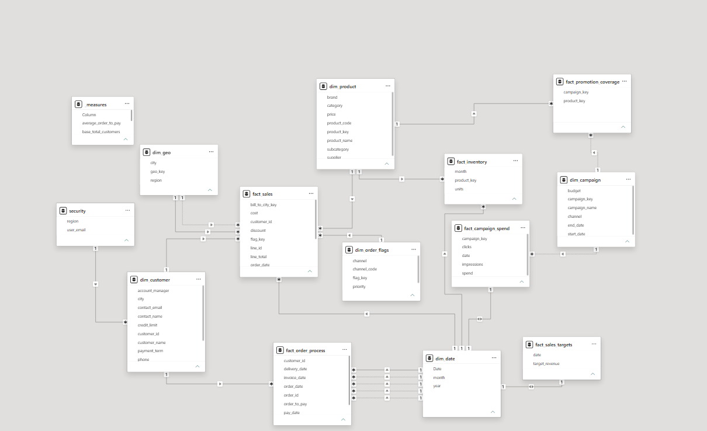

# Power BI Semantic Model — Technical Documentation

This document describes the architecture, modelling decisions, and validation approach for a Power BI semantic model spanning **sales, inventory, marketing, order fulfilment, and sales targets**.

> **Project status:** The table inventory and broad architecture are based on the current model screenshots. Exact relationship settings, DAX definitions, security rules, and validation results must be checked in the `.pbix` file. Items requiring confirmation are identified below.

## 1. Model architecture



The model currently shows **14 tables**: six fact tables, six dimension tables, and two supporting tables. It brings several business processes into a common reporting layer, using descriptive dimensions to analyse measures by customer, product, geography, campaign, and date where relationships permit.

### Fact tables

| Table | Example columns visible in model | Analytical role |
| --- | --- | --- |
| `fact_sales` | `customer_id`, `order_date`, `line_total`, `cost`, `discount` | Sales activity and financial measures |
| `fact_inventory` | `month`, `product_key`, `units` | Inventory quantities; snapshot versus movement requires confirmation |
| `fact_campaign_spend` | `campaign_key`, `date`, `spend`, `clicks`, `impressions` | Campaign spend and engagement |
| `fact_promotion_coverage` | `campaign_key`, `product_key` | Campaign-to-product coverage; may function as a factless fact or bridge |
| `fact_order_process` | `customer_id`, `order_id`, `order_date`, `invoice_date`, `delivery_date`, `pay_date`, `order_to_pay` | Order fulfilment and payment lifecycle |
| `fact_sales_targets` | `date`, `target_revenue` | Planned revenue for actual-versus-target analysis |

### Dimension and supporting tables

| Table | Example columns visible in model | Role |
| --- | --- | --- |
| `dim_customer` | `customer_id`, `customer_name`, `city`, `account_manager`, `payment_term` | Customer attributes and segmentation |
| `dim_product` | `product_key`, `product_name`, `category`, `brand`, `supplier` | Product attributes |
| `dim_geo` | `geo_key`, `city`, `region` | Geography attributes |
| `dim_date` | `Date`, `month`, `year` | Shared calendar attributes |
| `dim_campaign` | `campaign_key`, `campaign_name`, `channel`, `start_date`, `end_date`, `budget` | Campaign attributes |
| `dim_order_flags` | `flag_key`, `priority`, `channel_code` | Order classifications |
| `_measures` | `average_order_to_pay`, `base_total_customers` | Organization of DAX measures |
| `security` | `region`, `user_email` | Potential security mapping; presence does not confirm active RLS |

## 2. Grain and aggregation

**Grain** describes what a single row represents. Each fact table must retain its own grain so that measures aggregate correctly.

| Table | Grain to establish | Main risk to check |
| --- | --- | --- |
| `fact_sales` | Order line or other sales event | Duplicating revenue when joining to another fact |
| `fact_inventory` | Product-by-month snapshot or movement | Incorrectly summing stock balances across months |
| `fact_campaign_spend` | Campaign-by-date, or finer | Double-counting spend across channels or rows |
| `fact_promotion_coverage` | Campaign–product association | Duplicate pairs and ambiguous filtering |
| `fact_order_process` | One row per order, or another event | Multiple payments or invoices per order |
| `fact_sales_targets` | Daily, monthly, or other planning level | Repeating target amounts at finer granularity |

**Modelling principle:** Compare measures from different fact tables only at compatible levels of detail. For monthly inventory snapshots, an end-of-period stock measure may be more appropriate than summing monthly stock balances.

## 3. Relationships and filtering

The model shows active and inactive relationships. Exact keys, cardinalities, filter directions, and active states should be confirmed in **Power BI Desktop → Model view → Manage relationships**.

| Expected connection to inspect | Candidate key | Verification status |
| --- | --- | --- |
| `dim_customer` → `fact_sales` | `customer_id` | Not yet recorded |
| `dim_customer` → `fact_order_process` | `customer_id` | Not yet recorded |
| `dim_product` → `fact_sales` | `product_key` (confirm sales column) | Not yet recorded |
| `dim_product` → `fact_inventory` | `product_key` | Not yet recorded |
| `dim_product` → `fact_promotion_coverage` | `product_key` | Not yet recorded |
| `dim_campaign` → `fact_campaign_spend` | `campaign_key` | Not yet recorded |
| `dim_campaign` → `fact_promotion_coverage` | `campaign_key` | Not yet recorded |
| `dim_date` → date-bearing facts | Relevant date column | Not yet recorded |
| `dim_geo` → related business data | Geography key or attribute | Not yet recorded |
| `dim_order_flags` → related order data | `flag_key` | Not yet recorded |

These are **relationships to inspect, not a verified export** of the model's relationship settings.

### Important design considerations

- Prefer one-to-many relationships from unique dimension keys to fact foreign keys, with single-direction filtering where appropriate.
- Check for unexpected many-to-many relationships, bidirectional filters, and ambiguous fact-to-fact filter paths.
- Verify that dimension keys are unique and that fact-side foreign keys have matching dimension rows.
- Confirm the granularity of target and campaign data before creating cross-process calculations.

### Date relationships

`fact_order_process` includes `order_date`, `invoice_date`, `delivery_date`, and `pay_date`. These dates represent different stages of the same business process. If several connect to `dim_date[Date]`, only the intended default relationship should be active on a given relationship path.

Alternative date perspectives can be implemented with `USERELATIONSHIP()` inside a measure or through separate role-playing date dimensions. The actual strategy used in this file should be documented after checking the relationships.

Verify that `dim_date[Date]` is unique, continuous across the required date range, and configured appropriately for time-intelligence calculations.

## 4. DAX measures

A dedicated `_measures` table is present. The screenshots show the measure names below, **but not their formulas**.

| Existing measure name | Intended interpretation to confirm | Check |
| --- | --- | --- |
| `average_order_to_pay` | Average time between order and payment | Exclusion of unpaid orders, invalid dates, and row-grain assumptions |
| `base_total_customers` | Number of customers in the current filter context | `COUNT` versus `DISTINCTCOUNT`, and which customer population is counted |

To complete this section, copy the actual definitions from the Power BI formula bar and explain what each returns and how filters affect it. Avoid including an example formula as if it were already implemented.

### Potential independent extension: payment performance

The order lifecycle data could support an additional analysis of:

- Average days from order to payment for paid orders.
- Orders without a recorded payment date (not necessarily overdue).
- Payment duration by customer or region.
- Changes in payment duration over time.

Before building overdue-payment metrics, define the due-date rule using available invoice dates, payment terms, and contractual rules. Missing payment dates must not automatically be classified as overdue.

## 5. Data quality and validation

The following checks are a **validation plan**. They should not be described as passed until tested.

| Validation | How to test | Result |
| --- | --- | --- |
| Dimension keys | Check for null and duplicate IDs | Pending |
| Foreign key coverage | Identify fact keys with no dimension match | Pending |
| Date sequence | Review order, invoice, delivery, and payment chronology | Pending |
| Sales totals | Reconcile Power BI results with source-level totals | Pending |
| Target grain | Check aggregation by date and business level | Pending |
| Slicer filtering | Test customer, product, geography, date, and campaign filters | Pending |
| Inventory quantities | Confirm whether `units` is a balance or a movement | Pending |
| RLS | Test configured roles using **View as**, if applicable | Pending |

Record concrete findings after running each check, including any fixes made and the resulting figures.

## 6. Security

The model contains a `security` table with fields such as `region` and `user_email`. That table alone **does not establish that row-level security is implemented**.

If RLS is configured, document the roles, filter expressions, propagation paths, and results of the **View as** tests. Remove or anonymize personal information and confidential business data before publishing the `.pbix` file or screenshots.

## 7. Repository files

```text
powerbi-multi-process-data-model/
├── README.md
├── model-documentation.md
├── data-modeling.pbix
└── screenshots/
    ├── model-overview.png
    └── table-relationships.png
```

The filenames above describe the intended repository structure. Remove entries for files that have not yet been uploaded. Add further evidence, such as screenshots of actual DAX definitions or completed report pages, when available.

## 8. Next steps

- [ ] Confirm the grain and primary/foreign keys for each fact table.
- [ ] Export or record actual relationship settings.
- [ ] Document existing DAX formulas and explain their filter context.
- [ ] Run and record the data-quality checks.
- [ ] Verify RLS only if roles are configured.
- [ ] Add one independently designed business analysis and summarize its findings.

---

**Documentation scope:** This file records the visible architecture and the technical checks needed to verify it. It does not claim that untested relationships, calculations, or security settings have been validated.
